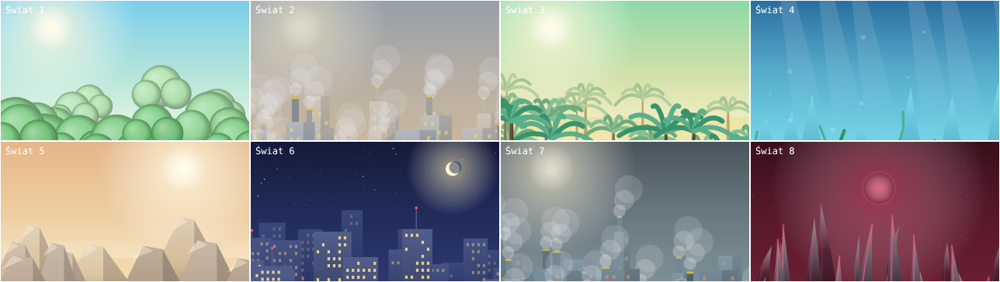

# Marioosh & Darioosh: Klątwa Katoblepasa

Dwuwymiarowa platformówka o dwóch braciach, ośmiu planetach, jednym przedłużaczu i kaucji, której nie wolno zmarnować.
**Platformy:** przeglądarka (www/PWA) · Windows · Linux · Android · iOS — jeden kod źródłowy (TypeScript + Canvas 2D).
**Języki w grze:** polski, English, 中文 (简体), español, Kiswahili, العربية (z układem od prawej do lewej).

> *A 2D platformer about two brothers, eight planets, one extension cord and a deposit you must not waste.
> One TypeScript code base ships to web, Windows, Linux, Android and iOS; the game is fully localised in Polish, English, Chinese, Spanish, Swahili and Arabic (RTL).*



## Spis treści
- [Co jest w grze](#co-jest-w-grze) · [Sterowanie](#sterowanie) · [Uruchomienie](#uruchomienie) · [Wydania](#wydania-i-platformy)
- [Testy](#testy) · [Struktura repozytorium](#struktura-repozytorium) · [Dokumentacja](#dokumentacja) · [Stan i ograniczenia](#stan-i-ograniczenia) · [English summary](#english-summary)

## Co jest w grze
- **32 poziomy** w 8 światach (po 3 poziomy + walka z bossem), mapa Wielkiej Sieci Kablowej, warpy, pokoje bonusowe i sekretne, poziom bonusowy Pradowo.
- **19 gatunków wrogów, 8 bossów**, przewody (niebieskie skróty, zielone bonusy, żółte sekrety, fioletowe warpy), bramy i przełączniki, ruchome/znikające/kruszące się platformy, taśmy, woda, tryb wieży, ciemne pokoje z latarniami.
- **Dwaj bracia:** Marioosh (siła, klucz 2 obrażenia) i Darioosh (zwinność, klucz 1 obrażenie, krótszy cooldown); tryb solo (przełączanie, wspólne życia) i **co-op na jednej klawiaturze** (osobne życia, ratowanie partnera).
- **Skamienienie** (miernik, progi 35/65, w co-op posąg 4 s), ulepszenia czasowe (magnes, rozszerzacz, rękawice, gwiazda), cewka iskier, tarcza.
- **Kaucja:** opakowania PET (100 pkt / 0,50 zł), puszki (150 pkt / 0,50 zł), złota puszka (750 pkt / 2,50 zł, liczy się jako *jedno* opakowanie); +1 życie za każde 100; EcoPort wypłaca kaucję.
- 96 mieszkańców do uwolnienia, 8 fragmentów kryształu (7 od strażników + 8-3), zapiski, zakończenie zwykłe i prawdziwe (wymaga wszystkich 8 fragmentów).
- 3 sloty zapisu (zapis atomowy), ustawienia (głośność, napisy, ograniczenie błysków/trzęsienia, przypisanie klawiszy), pad, sterowanie dotykowe.
- **Nowa warstwa grafiki HD:** 12 dodatkowych ilustracji SVG przeciwników i 9 teł planet jest wczytywanych do Canvas; pozostałe grafiki nadal są generowane proceduralnie jako fallback. Muzyka jest syntezowana w WebAudio. Zob. [`docs/art/HD_ASSET_PACK_WAVE1.md`](docs/art/HD_ASSET_PACK_WAVE1.md).

## Sterowanie
| Akcja | Gracz 1 (solo: oba zestawy działają) | Gracz 2 (co-op) | Pad |
|---|---|---|---|
| Ruch | `A` `D` / `W` `S` | strzałki | lewa gałka / D-pad |
| Skok | `Spacja` | `.` | A (dół) |
| Bieg | `Shift` | `,` | B / spusty |
| Klucz (atak) | `F` | `/` | X |
| Użyj (przewód, przełącznik, posąg) | `E` (lub `S` na przewodzie) | `'` | Y |
| Zmiana brata (solo) | `Q` | `;` | LB |
| Pauza | `Esc` / `P` | | Start |
| Pełny ekran | `F` w menu / `F11` (desktop) | | |

Na telefonach pojawiają się przyciski dotykowe (rozmiar w ustawieniach). Klawisze można przypisać w *Ustawienia → Klawisze*.

## Uruchomienie
Wymagany Node.js ≥ 20.
```bash
npm ci
npm run dev        # serwer deweloperski (http://localhost:5173)
npm run build      # produkcyjny build do dist/ (≈ 300 KB + czcionki)
npm run preview    # podgląd builda
```
Gotowy build webowy działa z dowolnego hostingu statycznego (ścieżki względne) oraz offline jako PWA.
Szczegóły i budowanie na wszystkie platformy: [`docs/BUILDING.md`](docs/BUILDING.md).

## Wydania i platformy
Po wypchnięciu tagu `vX.Y.Z` workflow **Release** buduje i dołącza do wydania na GitHubie:

| Platforma | Artefakt | Uwagi |
|---|---|---|
| www | `Marioosh-web-vX.Y.Z.zip` + GitHub Pages | PWA, offline |
| Windows | `Marioosh-<ver>-win-x64.exe` (NSIS) + `.zip` | niepodpisany (SmartScreen ostrzeże) |
| Linux | `.AppImage`, `.deb`, `.tar.gz` | x64 |
| Android | `Marioosh-android-tester.apk` (z wyborem poziomów; bez keystore) lub podpisany `.apk`/`.aab` (z sekretami keystore) | Android 7+ (WebView) |
| iOS | `Marioosh-ios-simulator.zip` | build bez podpisu; **IPA do App Store/TestFlight wymaga konta Apple Developer** — patrz [`docs/PLATFORMS.md`](docs/PLATFORMS.md) |

## Testy
```bash
npm run check      # typecheck + testy jednostkowe
npm run test:e2e   # test dymny w przeglądarce (zrzuty ekranu w e2e/out/), wymaga wcześniejszego npm run build
```
Zakres: fizyka i skoki (kryterium M1), generator i budżety 32 poziomów, rachunek opakowań (99/100/101), zapis/migracja, komplet i spójność 6 tłumaczeń, walka/stomp/skamienienie/co-op, automatyczny **bot osiągalności** na poziomach, test e2e w Chromium (6 języków, wejście do gry). Szczegóły i znane luki: [`docs/TESTING.md`](docs/TESTING.md).

## Struktura repozytorium
```
src/engine/   wejście, grafika (Canvas), dźwięk (WebAudio), i18n, ustawienia, zapis
src/game/     fizyka, ruch, świat, wrogowie, bossowie, generator poziomów, sesja i zapis
src/sprites/  ilustracje wektorowe HD + dotychczasowa grafika proceduralna
src/scenes/   tytuł, menu, mapa, rozgrywka, fabuła
src/data/     poziomy i bestiariusz (JSON z projektu), słowniki 6 języków
docs/design/  projekt etapu 1–2 (koncepcja, GDD, atlas poziomów, bestiariusz, biblia graficzna)
docs/art/     eksport grafik (PNG)    docs/*.md  dokumentacja techniczna
desktop/      powłoka Electron        mobile/    Capacitor (Android + iOS)
tests/ e2e/   testy                   .github/    CI, Pages, Release
```

## Dokumentacja
[Architektura](docs/ARCHITECTURE.md) · [Budowanie](docs/BUILDING.md) · [Platformy](docs/PLATFORMS.md) · [Testowanie](docs/TESTING.md) · [Lokalizacja](docs/LOCALIZATION.md) · [Licencje](docs/LICENSES.md) · [Zmiany](CHANGELOG.md) · [Projekt gry (GDD itd.)](docs/design/README.md)

## Stan i ograniczenia
**Migracja grafiki HD:** dostępna jest pierwsza seria 12 przeciwników i 9 teł planet w SVG. Wcześniejsze portrety referencyjne braci i bossów oraz pełne animacje nie są jeszcze zastąpione finalnymi ilustracjami; trwa stopniowa wymiana assetów. Grafiki pochodzące od użytkownika służą za wzorce kierunku artystycznego, ale nie są jeszcze częścią repozytorium.

Wersja **0.1.0** — pierwsza kompletna, grywalna implementacja projektu z etapu 2. Uczciwie:
- Poziomy są **generowane proceduralnie** z blueprintu (`src/data/levels.json`) deterministycznym ziarnem, a nie ręcznie projektowane; ich przejezdność weryfikują testy geometrii oraz bot, ale **7 poziomów** (W3-L4, W6-L2, W7-L1…L4, W8-L4) jest poza zasięgiem bota i wymaga testu ręcznego ([tryb testera](docs/TESTING.md#tryb-testera-ręczne-sprawdzenie-poziomów): `?debug=1`). Balans (prędkości, HP bossów) to wartości startowe.
- Paczki Windows/Linux/Android/iOS **kompilują się w CI** (GitHub Actions), ale **nie były uruchamiane** na docelowych systemach/urządzeniach; uruchomiono i przetestowano wersję web (Chromium, e2e).
- Tryb *Night Shift* jest wdrożony tylko częściowo: +12% prędkości gry, −10% czasu, nocna poświata i ciemny strój. Nie zmienia układu tras ani nie dodaje poziomów bonusowych z roadmapy.
- Tłumaczenia wykonane maszynowo/redakcyjnie — zalecana weryfikacja przez rodzimych użytkowników (zwłaszcza suahili i arabski). Zob. [`docs/LOCALIZATION.md`](docs/LOCALIZATION.md).

## English summary
**Marioosh & Darioosh: The Curse of Katoblepas** is a 2D platformer for two brothers (solo or local co-op), 8 worlds / 32 levels, 19 enemy kinds and 8 bosses, a bottle-deposit economy (PET/can/golden can, +1 life per 100 packages), petrification meter, cables/warps/secrets, 3 save slots, gamepad and touch controls. The game now supports SVG HD art assets (initial enemy and background set); remaining art is drawn procedurally as a fallback. Music is synthesised with WebAudio.

```bash
npm ci && npm run dev        # play in the browser
npm run check                # typecheck + unit tests
npm run build && npm run test:e2e
```
Releases (tag `vX.Y.Z`) are built by GitHub Actions for web, Windows, Linux, Android and iOS (unsigned simulator build — signing needs your Apple/Android credentials). See [`docs/PLATFORMS.md`](docs/PLATFORMS.md). Known gaps: levels are procedurally generated from the stage-2 blueprint, 7 levels are beyond the reachability bot and need manual playtesting, and Android/iOS binaries have not been run on physical devices by the author.

Licence: code MIT (see `LICENSE`), fonts SIL OFL 1.1 — see [`docs/LICENSES.md`](docs/LICENSES.md).
